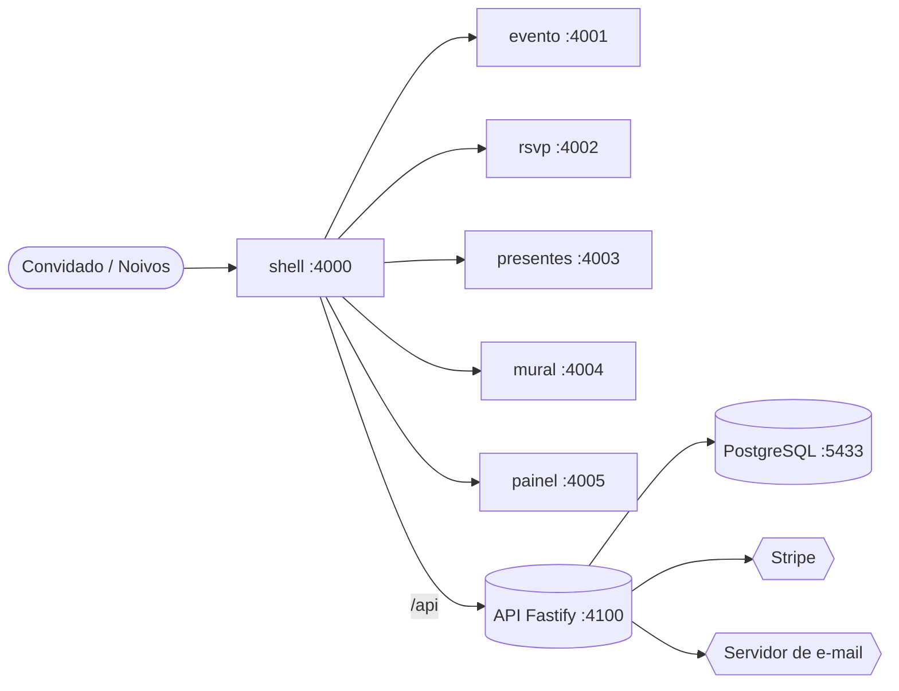
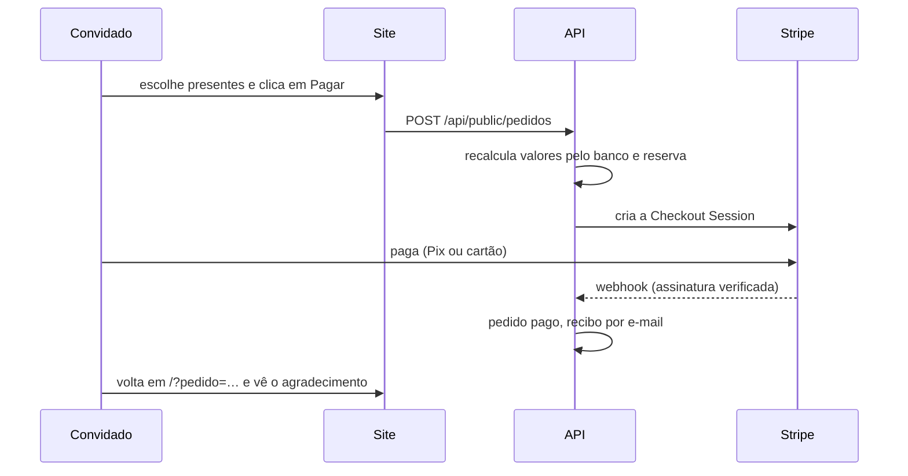
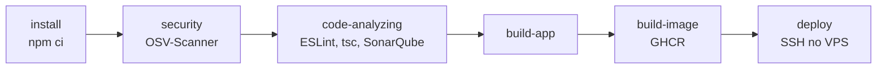

<div align="center">


# Nayara & Victor

**28 de agosto de 2027 · Paróquia São José · Itu, SP**

O site do nosso casamento: convite, confirmação de presença, lista de presentes, álbum de fotos e mural de recados, mais um painel para os noivos cuidarem de tudo.

[**casamentonayaraevictor.com.br**](https://casamentonayaraevictor.com.br) · [Painel dos noivos](https://casamentonayaraevictor.com.br/painel) · [Ver a abertura do mapa](https://casamentonayaraevictor.com.br/#mapa)


</div>

---

## ✨ O que tem no site

| | Para os convidados | Para os noivos (painel) |
| --- | --- | --- |
| 🗺️ | **Abertura "Mapa do Maroto"**: o folheto se desdobra em sanfona, pegadas com fitas andam pelos corredores até a igreja | |
| 💌 | **Confirmação de presença** pelo código ou QR Code do convite | Convidados, link de WhatsApp, QR Codes para imprimir |
| 🎁 | **Lista de presentes** com carrinho, **Pix e cartão** pelo Stripe | Presentes e categorias com arrastar e soltar; recebidos com taxa real |
| 📷 | **Álbum de fotos retrô** que abre como um livro, com páginas virando | Envio de fotos, legendas, momentos e ordem |
| 💬 | **Mural de recados** | Moderação dos recados |
| 🚪 | **Check-in na portaria** com leitor de QR | |
| ✉️ | Recibo do presente por e-mail | Reenvio de recibos, usuários e convites por e-mail |

---

## 📚 Sumário

- [Começando em 5 minutos](#comecando)
- [Como o projeto é organizado](#organizacao)
- [Recursos em detalhe](#recursos)
- [Pagamentos (Stripe)](#pagamentos)
- [E-mail](#email)
- [Deploy](#deploy)
- [Referência da API](#api)
- [Antes do grande dia](#checklist)

---

<a id="comecando"></a>

## 🚀 Começando em 5 minutos

Você precisa de **Node 24** e **Docker**.

```bash
cp .env.example .env     # ajuste as senhas
npm install
npm run docker:up        # Postgres + API + Mailpit (as migrations rodam sozinhas)
npm run db:seed          # conta do painel (ADMIN_*) e conteúdo de exemplo
npm run dev              # os 6 frontends
```

| Abra | Endereço |
| --- | --- |
| 🌸 Site | http://localhost:4000 |
| 🔐 Painel | http://localhost:4000/painel (login com `ADMIN_EMAIL` / `ADMIN_PASSWORD` do `.env`) |
| 📬 E-mails de teste (Mailpit) | http://localhost:8025 |
| 🗺️ Rever a abertura | http://localhost:4000/#mapa |

<details>
<summary><b>Todos os comandos</b></summary>

| Comando | O que faz |
| --- | --- |
| `npm run dev` | sobe o shell e os 5 microfrontends com hot reload |
| `npm run dev:api` | API fora do Docker, usando o Postgres do Docker |
| `npm run build` | build de produção de todos os frontends |
| `npm run typecheck` | TypeScript em tudo (`typecheck:backend` / `typecheck:frontend`) |
| `npm run lint` | ESLint em tudo (`lint:backend` / `lint:frontend`) |
| `npm run docker:up` · `docker:down` · `docker:logs` | ciclo de vida dos containers |
| `npm run db:seed` · `db:psql` | seed e console do banco |
| `docker compose --profile site up -d --build` | o site completo igual à produção (Nginx) em http://localhost:8088 |

</details>

---

<a id="organizacao"></a>

## 🧩 Como o projeto é organizado

Microfrontends com **Module Federation**: o `shell` monta a página e carrega cada seção de um app independente. Se um deles cair, só aquela seção mostra um aviso; o resto do site continua no ar.



| App | Porta | Cuida de | Expõe |
| --- | --- | --- | --- |
| `apps/shell` | 4000 | navegação, capa, contagem regressiva, rodapé, abertura do mapa; `/painel` abre o painel | — |
| `apps/evento` | 4001 | cerimônia e recepção, traje, local | `evento/Evento`, `evento/Traje`, `evento/Local` |
| `apps/rsvp` | 4002 | confirmação de presença, QR Code, check-in e leitor da portaria | `rsvp/Rsvp`, `rsvp/Portaria` |
| `apps/presentes` | 4003 | lista de presentes, carrinho e checkout | `presentes/Presentes` |
| `apps/mural` | 4004 | álbum de fotos e recados | `mural/Galeria`, `mural/Recados` |
| `apps/painel` | 4005 | painel dos noivos | `painel/Painel` |
| `apps/api` | 4100 | API REST, migrations em `apps/api/migrations/*.sql` | — |
| `packages/shared` | — | tema, ornamentos, dados do casamento, cliente da API, tipos, config de federation | — |

React e React DOM são compartilhados como singleton. Os frontends sempre chamam `/api` na própria origem (os dev servers e o Nginx repassam para a API), então o cookie de sessão fica no domínio do site. O design original está em `design/`.

---

<a id="recursos"></a>

## 🌸 Recursos em detalhe

### 🗺️ Abertura "Mapa do Maroto"

Uma homenagem com arte original. O cursor vira uma varinha com o juramento *"Eu juro solenemente que vou celebrar com vocês."*. Ao tocar no folheto, as duas sanfonas se desdobram a partir do painel central, as pegadas dos Marotos e dos noivos andam pelos corredores com os nomes em fitas, e o casal se encontra na igreja. Então aparece *"Com muito amor esse dia será feito."* e a home surge no pergaminho.

- Aparece na **primeira visita** de cada pessoa; reveja com `#mapa` ou pelo botão **✦ Rever o mapa** no rodapé.
- Som opcional (papel e passos), botão **Pular abertura** e versão sem animação para quem reduz movimentos no sistema.
- Código: `apps/shell/src/components/` (`MapaMaroto.tsx`, `CapaMapa.tsx`, `PlantaMapa.tsx`, `Varinha.tsx`, `mapa.css`).

### 📷 Álbum de fotos

Capa de linho rosé com costura, páginas de papel (página dupla com lombada no computador), fotos reveladas com cantoneiras e legenda manuscrita, com paginação. Ao tocar numa foto, o álbum abre como um **livro** com páginas que viram.

No painel, aba **Galeria**: enviar várias fotos de uma vez (com o momento: Nós dois, O pedido, Viagens, Família ou O casamento), editar legenda, momento e imagem, excluir e reordenar arrastando. As imagens são guardadas com até 2000 px. Sem fotos, aparece "Em breve, nossas fotos".

### 🎁 Fotos dos presentes

Upload de JPG, PNG, WebP ou HEIC até 10 MB. A API re-codifica com `sharp` (até 1200 px, WebP, sem metadados como GPS) e guarda no volume `uploads-data`, servindo em `/api/uploads/<arquivo>.webp` com cache longo. Arquivos antigos são apagados ao trocar ou excluir.

### 🔗 Links especiais

| Link | Abre |
| --- | --- |
| `/#convite=NV-A1B2` | o RSVP já com o convite identificado (o painel monta a mensagem de WhatsApp) |
| `/#checkin=NV-A1B2` | a validação na portaria (QR Code mostrado após o RSVP) |
| `/#scanner` | o leitor de QR da portaria (câmera do celular) |
| `/#mapa` | a abertura do mapa de novo |

No painel, cada convidado tem o botão **QR Code** (PNG em alta ou impressão) e a aba Convidados tem **Imprimir QR Codes**: uma folha A4 com QR, nome e código de todos os convites filtrados.

### 👥 Contas do painel

- **Minha conta** (qualquer usuário): editar nome e trocar senha; os outros aparelhos conectados saem.
- **Usuário master** (a conta do `ADMIN_EMAIL`): o único que vê a aba **Configurações** e gerencia usuários. A API também barra os outros (403).
- **Convidar usuários** (só o master): o convidado recebe "Criar minha senha" com um link de uso único que vale 7 dias. Se o e-mail não sair, o painel mostra o link para copiar.
- **Esqueci minha senha**: link de uso único que vale 1 hora. A resposta é sempre a mesma, exista a conta ou não, com limite de 3 e-mails por endereço e 10 pedidos por IP por hora.

<details>
<summary><b>Criar ou atualizar uma conta pela linha de comando</b></summary>

O seed cria ou atualiza a conta de `ADMIN_EMAIL`, `ADMIN_NOME` e `ADMIN_PASSWORD` (mínimo 10 caracteres). Ele só cria conteúdo de exemplo com as tabelas vazias e nunca apaga nada.

```bash
docker compose exec -e ADMIN_EMAIL=nayara@exemplo.com -e ADMIN_NOME=Nayara -e ADMIN_PASSWORD='uma-senha-forte' api node src/seed.ts
```

Em produção, o `ADMIN_PASSWORD` só é aplicado de novo quando o secret **muda** (guardamos um hash do último valor aplicado), então trocar a senha pelo painel não é desfeito no próximo deploy.

</details>

### 🎨 Tema claro em qualquer celular

O site tem um único visual claro. Ele declara um "tema escuro" que é a mesma paleta (`color-scheme: light dark` em `packages/shared/src/theme.css` e na meta do HTML), que é o sinal que o Samsung Internet e o modo escuro do Chrome usam para não repintar a página. Algumas versões do Samsung Internet forçam o escuro mesmo assim; nesse caso, só o usuário resolve em *Configurações → Labs → Usar tema escuro do site*.

---

<a id="pagamentos"></a>

## 💳 Pagamentos (Stripe)

O carrinho termina no **Stripe Checkout**:



- **O navegador nunca define preço**: a API recalcula tudo pelo banco.
- **Taxa embutida**: cada presente é cadastrado com o valor que os noivos querem receber; o site cobra esse valor **mais 5,99% + R$ 0,39** (cartão internacional, o caso mais caro; ajustável em Configurações). O preço é calculado de trás para frente, `(valor + fixo) / (1 − percentual)`, para sobrar exatamente o valor cadastrado. Regra única em `packages/shared/src/taxas.ts`, usada no site e na API.
- **Presente único ou cota**: "Pode ser presenteado" 1 vez, quantas vezes quiserem (ex.: lua de mel) ou uma quantidade definida. A unidade fica reservada enquanto alguém paga (30 min) e a API trava a disponibilidade numa transação, então dois convidados não pagam o mesmo presente.
- **Taxa real**: cada pedido pago guarda a forma de pagamento e a taxa real do Stripe (da *balance transaction*). O painel mostra bruto, taxa e líquido.
- **Formas de pagamento** são ligadas no [Dashboard do Stripe](https://dashboard.stripe.com/settings/payment_methods), não no código. O Pix vale 4 horas.

<details>
<summary><b>Testar pagamentos em desenvolvimento</b></summary>

1. Coloque a chave de **teste** (`sk_test_...`, em https://dashboard.stripe.com/test/apikeys) em `STRIPE_SECRET_KEY` no `.env`.
2. Suba a Stripe CLI e copie o `whsec_...` que ela mostra:
   ```bash
   docker compose --profile stripe up -d stripe-cli
   docker compose logs stripe-cli
   ```
3. Coloque o `whsec_...` em `STRIPE_WEBHOOK_SECRET` e recrie a API: `docker compose up -d api`.
4. Teste:
   - **Cartão:** `4242 4242 4242 4242`, qualquer validade futura e CVC.
   - **Pix:** CPF `000.000.000-00` e *Simular digitalização*. O e-mail controla a simulação: `qualquer+succeed_immediately@exemplo.com` confirma na hora, `qualquer+expire_immediately@exemplo.com` expira, e um e-mail comum confirma em ~3 minutos.

</details>

<details>
<summary><b>Stripe em produção</b></summary>

Use a chave **live** e crie no Dashboard um webhook para `https://casamentonayaraevictor.com.br/api/stripe/webhook` com os eventos `checkout.session.completed`, `checkout.session.async_payment_succeeded`, `checkout.session.async_payment_failed` e `checkout.session.expired`. A chave e o `whsec_...` vão nos secrets `STRIPE_SECRET_KEY` e `STRIPE_WEBHOOK_SECRET` do GitHub.

</details>

---

<a id="email"></a>

## ✉️ E-mail

Quando um presente é pago, o convidado recebe um **recibo** no visual do site (itens, total, forma de pagamento, número do pedido e a mensagem dele). O envio acontece uma única vez por pedido, e a aba **Recebidos** mostra o status e tem **Reenviar recibo**. Convites e recuperação de senha do painel também saem por e-mail.

- **Desenvolvimento:** o **Mailpit** recebe tudo em http://localhost:8025. Nada sai da sua máquina.
- **Produção:** servidor de e-mail compartilhado, que **só envia** (não há caixas, IMAP nem webmail). Ele roda em **outro projeto Docker** no mesmo VPS porque atende vários domínios. Remetente: `Nayara & Victor <nao-responder@casamentonayaraevictor.com.br>`.

<details>
<summary><b>Servidor de e-mail compartilhado (@casamentonayaraevictor.com.br)</b></summary>

O servidor é de outro projeto e serve vários domínios. Ele **só envia**: não recebe e-mails, não tem caixas, IMAP nem webmail. Este site só o usa para **enviar recibos, convites e recuperação de senha** (remetente `nao-responder@`) pela porta 25, sem login, entrando na rede Docker do projeto de e-mail.

**No `/opt/casamento/.env` do servidor** (veja [docker/.env.producao.example](docker/.env.producao.example)):

| Variável | Para quê |
| --- | --- |
| `EMAIL_REDE` | rede Docker do projeto de e-mail (padrão `email`), que precisa existir antes do deploy |
| `MAIL_HOSTNAME` | nome do servidor, o mesmo do certificado (padrão `mail.casamentonayaraevictor.com.br`). Precisa ser alias do container nessa rede, porque o STARTTLS confere o nome |

**No projeto de e-mail:** coloque a rede da API em `PERMIT_DOCKER` (ou `connected-networks`) para ela poder enviar sem login. Configure também o DKIM de `casamentonayaraevictor.com.br`.

**DNS do domínio (Registro.br):** SPF autorizando o servidor (ex.: `v=spf1 a:mail.casamentonayaraevictor.com.br -all`; sem `MX`, já que ele não recebe), a chave DKIM gerada no projeto de e-mail e DMARC `v=DMARC1; p=quarantine; adkim=s; aspf=s`.

**Localmente** não há servidor de e-mail: os envios caem no Mailpit.

</details>

---

<a id="deploy"></a>

## 🚢 Deploy (GitHub Actions → VPS)

Produção em **https://casamentonayaraevictor.com.br**, num VPS da Hostinger atrás do Traefik (HTTPS automático). Tudo no mesmo domínio: `/` é o shell, `/mf/<app>/` cada microfrontend e `/api/*` a API.

**Um push na `main` é o deploy.** Dois workflows, cada um disparado só quando a sua parte muda (ou à mão em *Actions → Run workflow*):

- **Backend** ([backend.yml](.github/workflows/backend.yml)): API → `ghcr.io/victorandrad/casamento-api`
- **Frontend** ([frontend.yml](.github/workflows/frontend.yml)): shell e microfrontends → `ghcr.io/victorandrad/casamento-web`



<details>
<summary><b>O que cada etapa faz</b></summary>

| Etapa | O que faz |
| --- | --- |
| install | `npm ci` com `node_modules` em cache ([.github/actions/dependencias](.github/actions/dependencias/action.yml)) |
| security | OSV-Scanner no `package-lock.json`: alertas em *Security → Code scanning* e issues `segurança` que fecham sozinhas ([issues-seguranca.mjs](.github/scripts/issues-seguranca.mjs)). Não bloqueia o deploy |
| code-analyzing | ESLint, TypeScript e um SonarQube temporário que vira issues `sonarqube` ([issues-sonarqube.mjs](.github/scripts/issues-sonarqube.mjs)) |
| build-app | frontend: build com as URLs de produção; backend: a API sobe contra um PostgreSQL com as migrations e precisa responder |
| build-image | publica no GitHub Container Registry com a tag do commit e `latest` ([api.Dockerfile](docker/api.Dockerfile), [web.dist.Dockerfile](docker/web.dist.Dockerfile)) |
| deploy | SSH no VPS ([deploy-vps.yml](.github/workflows/deploy-vps.yml)): a chave só pode rodar o `casamento-deploy`, que troca só aquele container e confere a home e `/api/health` |

O VPS não tem o código: em `/opt/casamento` ficam só o `.env`, o `segredos.env` (gravado pelo deploy), o [compose.yaml](compose.yaml) e o [compose.producao.yaml](compose.producao.yaml).

</details>

<details>
<summary><b>Secrets e variables do GitHub</b></summary>

Em *Settings → Secrets and variables → Actions*. A cada deploy o job manda os valores pelo SSH e o `casamento-deploy` grava em `/opt/casamento/segredos.env` (permissão 600). Mudou um valor? Rode *Actions → Backend → Run workflow*.

| Tipo | Nome | Para quê |
| --- | --- | --- |
| Secret | `VPS_SSH_KEY` | chave do deploy (presa ao `casamento-deploy`) |
| Secret | `ADMIN_EMAIL`, `ADMIN_PASSWORD` | login do dono do painel (usuário master) |
| Secret | `STRIPE_SECRET_KEY`, `STRIPE_WEBHOOK_SECRET` | Stripe em modo real |
| Variable | `ADMIN_NOME`, `EMAIL_FROM`, `EMAIL_REPLY_TO` | nome no painel e remetente dos e-mails |

</details>

<details>
<summary><b>Preparar um servidor novo (uma vez)</b></summary>

1. **DNS:** registros `A` de `casamentonayaraevictor.com.br` e `www` para `177.7.36.12`.
2. **Pasta:** crie `/opt/casamento/.env` a partir de [docker/.env.producao.example](docker/.env.producao.example) (senha do banco com `openssl rand -hex 24`).
3. **Script de deploy:** copie [docker/deploy-vps.sh](docker/deploy-vps.sh) para `/usr/local/bin/casamento-deploy` (`chmod 755`).
4. **Chave do GitHub Actions:**
   ```bash
   ssh-keygen -t ed25519 -f casamento-deploy -C github-actions-deploy@casamento -N ""
   ```
   No servidor, em `/root/.ssh/authorized_keys`, presa ao script:
   ```
   restrict,command="/usr/local/bin/casamento-deploy" ssh-ed25519 AAAA... github-actions-deploy@casamento
   ```
   A privada vai no secret `VPS_SSH_KEY`; crie também o ambiente `producao` em *Settings → Environments*.
5. **Banco:** `cd /opt/casamento && docker compose -f compose.yaml -f compose.producao.yaml up -d --wait db`. O Traefik (`traefik-duis-traefik-1`, rede `host`) acha o container `web` pelos labels.
6. **Painel e Stripe:** preencha os secrets; o deploy roda o seed sozinho.

</details>

<details>
<summary><b>Voltar uma versão e backup</b></summary>

- **Voltar uma versão:** no servidor, `casamento-deploy backend <commit>` ou `casamento-deploy frontend <commit>`.
- **Backup do banco:** `docker compose -f compose.yaml -f compose.producao.yaml exec -T db pg_dump -U casamento casamento > backup.sql`.
- **Fotos:** volume `casamento-nv_uploads-data`. Inclua no backup junto com o banco.

</details>

---

<a id="api"></a>

## 🔌 Referência da API

| Rota | Acesso | Uso |
| --- | --- | --- |
| `GET /api/public/convites/:codigo` · `PUT …/resposta` | público | RSVP pelo código do convite |
| `GET /api/public/checkin/:codigo` | público | validação na portaria |
| `GET/POST /api/public/recados` | público | mural (POST limitado a 5/hora por IP) |
| `GET /api/public/presentes` · `POST /api/public/pedidos` | público | lista e compra de presentes |
| `GET /api/public/galeria` | público | fotos do álbum |
| `POST /api/stripe/webhook` | Stripe | confirmação de pagamentos |
| `POST /api/auth/login` · `logout` · `GET me` | — | sessão do painel |
| `/api/auth/convite/:token` · `recuperar-senha` · `redefinir/:token` | — | convites e recuperação de senha |
| `/api/admin/*` | noivos | painel (alguns só para o master) |

🔒 **Segurança:** senhas com scrypt; sessão em cookie `HttpOnly` + `SameSite=Lax` (o banco guarda só o hash do token, validade de 30 dias); escritas de outras origens recusadas (`ALLOWED_ORIGINS`); login limitado a 5 tentativas a cada 15 min. Em produção, HTTPS com `COOKIE_SECURE=true`.

---

<a id="checklist"></a>

## 💍 Antes do grande dia

- [ ] Stripe em modo **live** com Pix e cartão ativos no Dashboard, e um pagamento real pequeno de teste
- [ ] Reputação do e-mail em https://www.mail-tester.com
- [ ] Fotos e legendas do álbum no painel
- [ ] Convites com QR Code impressos (aba Convidados → **Imprimir QR Codes**)
- [ ] Testar a portaria (`/#scanner`) num celular, no local
- [ ] Backup do banco e das fotos

<div align="center">

---

Feito com 🤍 para Nayara & Victor

</div>
